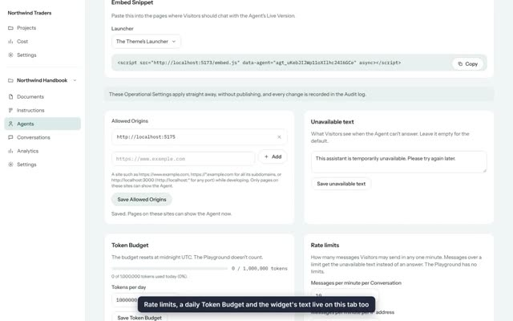
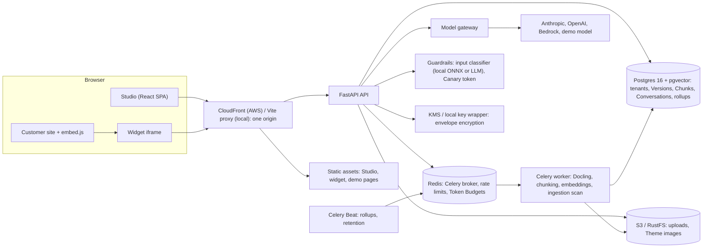

# RAG Agent Studio

[](https://github.com/EarthlingOllie/rag-agent-studio/actions/workflows/backend.yml)
[](https://github.com/EarthlingOllie/rag-agent-studio/actions/workflows/frontend.yml)
[](https://github.com/EarthlingOllie/rag-agent-studio/actions/workflows/e2e.yml)
[](https://github.com/EarthlingOllie/rag-agent-studio/actions/workflows/infra.yml)
[](https://github.com/EarthlingOllie/rag-agent-studio/actions/workflows/security.yml)
[-brightgreen)](https://github.com/EarthlingOllie/rag-agent-studio/actions/workflows/backend.yml)

**A multi-tenant platform for building retrieval-augmented AI Agents grounded in an organisation's own documents, shipping them like code, and embedding them safely on any website.**

Teams upload their documents, configure an Agent, test it in a Playground with full traces, publish immutable Versions, and embed it as a chat widget. Every answer cites its sources, every change can be diffed and reverted, every Visitor message passes layered prompt-injection defences, and analytics compare Versions with confidence intervals rather than guesswork.

[](docs/demo/04-publish-and-embed.mp4)

**[▶ Watch the demo videos: nine core user journeys in under six minutes](docs/demo.md)**

Contents: [Highlights](#highlights) · [Demo](#demo) · [Quickstart](#quickstart) · [Architecture](#architecture) · [Stack](#stack) · [Engineering practices](#engineering-practices) · [Testing](#testing) · [Security](#security) · [Deploy and destroy](#deploy-and-destroy-aws-demo) · [Documentation](#documentation)

## Highlights

- **Retrieval that is explainable.** Hybrid search (pgvector embeddings plus Postgres full-text, fused with reciprocal rank fusion) with an optional reranker and Tag scoping. Each answer opens a **Trace**: model, tokens, cost, latency and every Chunk retrieved, with the cited ones marked.
- **Two retrieval modes.** *Automatic* runs one search on the user's words before the model is called: cheap and predictable. *Agentic* gives the model a search tool, so it decides whether, how often and with what query to search. Both are traced, costed and evaluated.
- **A real ingestion pipeline.** PDF, DOCX, PPTX, HTML and Markdown are converted and chunked by Docling on a Celery worker, embedded locally (fastembed) or by a provider, deduplicated, versioned as editions and scanned for planted instructions before they can reach a prompt.
- **Agents shipped like software.** Immutable Agent Versions behind a movable Live pointer, diffs, Live History, one-click revert, bulk publish and Project-wide Instructions that Versions pin, with a rollout view showing which Agents are behind.
- **Defence in depth against prompt injection.** An ingestion scan for indirect injection, an input Guardrail (local ONNX classifier or LLM classifier) in block/warn/log mode, a Canary token that cuts off leaked prompts, and an Attack evaluation suite run in CI and nightly against a live model.
- **Honest analytics.** Thumbs and ratings from Visitors roll up daily into per-Version KPIs with Wilson score intervals, low-confidence marking below 30 Conversations, and cost per Project and per Agent.
- **Production concerns built in.** Multi-tenant isolation tested on every route, hand-rolled auth with TOTP MFA, KMS envelope encryption for provider API keys, origin-locked iframe embeds, rate limits, daily Token Budgets, retention, an Audit log, WCAG 2.2 AA, and Terraform for AWS.
- **Model-agnostic.** A gateway built on Pydantic AI talks to Anthropic, OpenAI and AWS Bedrock, with per-Organisation defaults, per-Agent overrides and a price table so every reply carries a cost. A labelled demo model lets the whole product run with no API key.

## Demo

Short screen recordings, each one user journey run end to end against the seeded stack:

1. [Sign up and create a Project](docs/demo.md#1-sign-up-and-create-a-project)
2. [Build a Knowledge Base](docs/demo.md#2-build-a-knowledge-base)
3. [Create an Agent and test it in the Playground](docs/demo.md#3-create-an-agent-and-test-it-in-the-playground)
4. [Publish an Agent and embed it on a website](docs/demo.md#4-publish-an-agent-and-embed-it-on-a-website)
5. [Iterate safely with Versions, Diffs and revert](docs/demo.md#5-iterate-safely-with-versions-diffs-and-revert)
6. [Review Conversations and compare Versions](docs/demo.md#6-review-conversations-and-compare-versions)
7. [Choose Automatic or Agentic retrieval](docs/demo.md#7-choose-automatic-or-agentic-retrieval)
8. [See the Guardrails stop prompt injection](docs/demo.md#8-see-the-guardrails-stop-prompt-injection)
9. [Manage the team, spending and audit trail](docs/demo.md#9-manage-the-team-spending-and-audit-trail)

To try it yourself, follow the [five-minute walkthrough](docs/demo.md#five-minute-walkthrough) after the [Quickstart](#quickstart); it is also automated as one Playwright test.

## Quickstart

Run the whole product locally with two commands. No API key is needed: the seeded demo answers with a clearly labelled demo model.

**Prerequisites:** Docker with Compose v2, GNU Make, [uv](https://docs.astral.sh/uv/), and Node 22 with pnpm (`corepack enable`).

```sh
git clone https://github.com/EarthlingOllie/rag-agent-studio.git
cd rag-agent-studio
cp .env.example .env   # optional: the defaults work locally

make dev     # builds and starts Postgres+pgvector, Redis, RustFS (S3), Mailpit, the API, worker, Beat, Studio, widget and demo pages
make seed    # in a second terminal: creates the demo Organisation and prints its sign-in details (idempotent)
```

Then open the Studio at <http://localhost:5173> and sign in:

| Role | Email | Password |
|---|---|---|
| Owner | `owner@northwind.example` | `northwind-owner-demo` |
| Editor | `editor@northwind.example` | `northwind-editor-demo` |

| URL | What's there |
|---|---|
| <http://localhost:5173> | The Studio: sign in as the demo Owner, or sign up to create your own Organisation |
| <http://localhost:8000/docs> | The API's OpenAPI docs |
| <http://localhost:5175/demo/> | Demo host pages: a shop with the chat bubble, `inline.html`, `budget.html` and the `attacks.html` panel |
| <http://localhost:5176/> | The same embed on a disallowed origin, which the browser refuses |
| <http://localhost:8025> | Mailpit: every email the stack sends (invites, password resets) |

**Useful extras**

- **Use a real model:** set `SEED_CREDENTIAL_PROVIDER` (`anthropic` or `openai`) and `SEED_CREDENTIAL_API_KEY` before `make seed`. You can also add credentials in the Studio under **Organisation settings → Credentials**.
- **Start again:** `make seed-reset` erases and rebuilds only the demo Organisation.
- **Run the checks:** `make services` then `make test`; `make lint`; `make e2e` for the full browser suite.
- `make help` lists every target, and [docs/development.md](docs/development.md) covers settings, ports and each subsystem in depth.

## Architecture



**Answering a question:** widget → API → admission control (Allowed Origin, rate limits, Token Budget) → input Guardrail → hybrid retrieval scoped by Tags (up front in Automatic mode, as a tool call in Agentic mode) → the Live Version's prompt and pinned Instructions → the model through the gateway → streamed back through the Canary filter with citations, and saved with its Trace.

**Ingesting a document:** upload to object storage → Docling conversion on the worker → chunking → ingestion scan → embedding into pgvector.

[docs/plan.md](docs/plan.md#2-architecture) has the full pipelines; [ADR-0010](docs/adr/0010-aws-runtime-shape.md) and [ADR-0011](docs/adr/0011-single-cloudfront-origin.md) describe the AWS shape.

## Stack

| Layer | Choices |
|---|---|
| Backend | Python 3.13, FastAPI, SQLAlchemy 2 (async, asyncpg), Alembic, Pydantic AI (model gateway), Celery with Redis, Docling, fastembed (local embeddings), ONNX classifier, Logfire telemetry with scrubbing, uv |
| Data | Postgres 16 with pgvector (vectors and full-text in one store), Redis 7, S3 (RustFS locally) |
| Frontend | pnpm workspace, React 19, TanStack Router and Query, Tailwind CSS 4, Vite, Recharts, a generated TypeScript API client; the widget and a dependency-free 1 KB loader |
| Testing | pytest against real Postgres and Redis (pytest-xdist), Vitest + Testing Library + MSW, Playwright + axe, `terraform test`, Node's test runner |
| Infrastructure | Terraform: ECS Fargate (ARM64), RDS, ElastiCache, S3, CloudFront, KMS, ECR, fck-nat; GitHub Actions with OIDC |
| Quality and security | ruff, `mypy --strict`, eslint, `tsc`, TFLint, Checkov, gitleaks, pip-audit, pnpm audit, Trivy |

## Engineering practices

The project was built the way a team would build it, and the paper trail is in the repository:

- **Spec-driven delivery.** Work was planned in [a build plan](docs/plan.md), broken into [specs](docs/specs/README.md), one per vertical slice, and then into [tickets](docs/tickets/README.md) with acceptance criteria and an evidence folder each (test logs, screenshots, e2e runs).
- **Decisions are written down.** Twelve [Architecture Decision Records](docs/adr) explain the trade-offs: why pgvector over a dedicated vector database, why local embeddings by default, why immutable Versions, why a hand-rolled auth layer.
- **A shared domain language.** [GLOSSARY.md](GLOSSARY.md) defines every term (Organisation, Agent, Version, Live Version, Guardrail, Canary token, …), and the code, UI and docs use them consistently.
- **CI gates on every push:** tests with 100% coverage, strict typing and linting, end-to-end tests with accessibility scans, the Attack evaluation suite, infrastructure tests, secret and dependency scanning, and a check that every link in the docs resolves.

## Testing

Backend and frontend are held at **100% line and branch coverage**, enforced in CI ([ADR-0008](docs/adr/0008-full-line-and-branch-coverage.md)). Behaviour is tested at the highest useful seam: the HTTP API against real Postgres and Redis, components through the DOM with MSW, and the whole stack through Playwright with axe accessibility scans; model providers, classifiers and clocks are swapped for test doubles at their ports ([shared test seams](docs/specs/README.md#shared-test-seams)). The Attack evaluation suite runs through the real Guardrail pipeline on every push (`make eval`) and nightly against a live model (`make eval-live`).

| Command | What it runs |
|---|---|
| `make services` then `make test` | Backend (`TEST_WORKERS=3` for parallel) and frontend suites with the coverage gates |
| `make lint` | ruff, `mypy --strict`, eslint, `tsc` |
| `make e2e` | Stack up, seed, Playwright + axe |
| `make eval` | The Attack evaluation suite (mocked model) |
| `make infra-check` | Terraform fmt, validate, test, TFLint, Checkov and the deploy scripts' tests |
| `make link-check` | Every relative link in the Markdown resolves |
| `make security` | gitleaks, pip-audit, pnpm audit, Trivy |

## Security

- **Layered prompt-injection defence** ([ADR-0007](docs/adr/0007-layered-prompt-injection-defence.md)): an ingestion scan flags planted instructions in Documents (mark or exclude from retrieval); an input Guardrail classifies every Visitor message (block, warn or log); a Canary token in the prompt cuts off any reply that leaks it; Agents have no side-effecting tools, so a successful injection can only ever produce text.
- **Envelope encryption for Provider Credentials.** Each credential is encrypted with its own data key, wrapped by KMS in AWS (a local key wrapper in development); plaintext keys never leave the API process or reach logs ([ADR-0006](docs/adr/0006-provider-credentials-envelope-encryption.md)).
- **Studio authentication.** Argon2 password hashes, httpOnly cookie sessions, sign-in rate limiting and lockout, TOTP MFA with an Organisation policy to require it, and an Audit Event for every change ([ADR-0005](docs/adr/0005-hand-rolled-studio-auth.md)). Every query is scoped to the Organisation, and a tenant-isolation test walks every route.
- **Embed protections** ([ADR-0004](docs/adr/0004-iframe-embed-with-origin-allowlist.md)): the widget is an iframe whose shell sends `Content-Security-Policy: frame-ancestors` with the Agent's Allowed Origins, short-lived signed Conversation tokens, per-Conversation and per-IP rate limits, and a daily Token Budget that caps spend.
- **Telemetry with scrubbing**, retention with tombstones for old Conversations, and security gates in CI: gitleaks, pip-audit, pnpm audit and Trivy.

## Deploy and destroy (AWS demo)

The AWS demo is applied on demand from GitHub Actions and destroyed after use; nothing is always on. Full details are in [docs/deploy-demo.md](docs/deploy-demo.md) and, once per account, [docs/infra-bootstrap.md](docs/infra-bootstrap.md).

1. **Bootstrap (once):** apply `infra/bootstrap` (the Terraform state bucket and the GitHub OIDC deploy role), then set the `AWS_DEPLOY_ROLE_ARN` secret and the `TF_STATE_BUCKET` variable.
2. **Deploy:** Actions → **deploy**. It builds and pushes ARM64 images, applies `infra/envs/demo`, runs migrations, rolls the API, worker and Beat services, uploads the static apps and smoke-checks the CloudFront URL it prints. From a laptop: `TF_STATE_BUCKET=… AWS_REGION=eu-west-2 scripts/deploy/deploy.sh <tag>`.
3. **Seed:** Actions → **seed**. Runs the same seed as `make seed` as a one-off ECS task and prints the URL and sign-in details; tick `reset` to rebuild the demo Organisation. From a laptop: `scripts/deploy/seed.sh [--reset]`.
4. **Destroy:** Actions → **destroy**, typing `destroy demo` to confirm. Everything goes except the state bucket and deploy role. From a laptop: `scripts/deploy/destroy.sh "destroy demo"`.

**Expected cost** (on-demand, `eu-west-2`, default sizes, almost no traffic; [the breakdown](docs/deploy-demo.md#expected-cost)): about **0.33 USD an hour**, or about **8 USD for a day** of demo. After destroy, about 1 USD a month remains.

## Documentation

- [docs/demo.md](docs/demo.md): the demo videos, the five-minute walkthrough and how to regenerate the recordings.
- [GLOSSARY.md](GLOSSARY.md): the domain language used in code, UI and docs.
- [docs/adr](docs/adr): the architecture decisions:
  [0001 pgvector hybrid search](docs/adr/0001-pgvector-hybrid-search.md) ·
  [0002 local embeddings by default](docs/adr/0002-local-embeddings-by-default.md) ·
  [0003 immutable Versions with a Live pointer](docs/adr/0003-immutable-versions-with-live-pointer.md) ·
  [0004 iframe embed with origin allowlist](docs/adr/0004-iframe-embed-with-origin-allowlist.md) ·
  [0005 hand-rolled Studio auth](docs/adr/0005-hand-rolled-studio-auth.md) ·
  [0006 envelope encryption](docs/adr/0006-provider-credentials-envelope-encryption.md) ·
  [0007 layered prompt-injection defence](docs/adr/0007-layered-prompt-injection-defence.md) ·
  [0008 100% coverage](docs/adr/0008-full-line-and-branch-coverage.md) ·
  [0009 Operational Settings outside Versions](docs/adr/0009-operational-settings-outside-versions.md) ·
  [0010 AWS runtime shape](docs/adr/0010-aws-runtime-shape.md) ·
  [0011 single CloudFront origin](docs/adr/0011-single-cloudfront-origin.md) ·
  [0012 demo seed through the API](docs/adr/0012-demo-seed-through-the-api.md)
- [docs/plan.md](docs/plan.md): the build plan, architecture and delivery slices.
- [docs/specs](docs/specs/README.md): one spec per slice, with the shared test seams.
- [docs/tickets](docs/tickets/README.md): every ticket, its acceptance criteria and its evidence.
- [docs/development.md](docs/development.md): local development in depth; [seed/README.md](seed/README.md): the synthetic demo content and its [licence](seed/LICENCE.md).

## Licence

[MIT](LICENSE). The demo content in `seed/` is synthetic; see [seed/LICENCE.md](seed/LICENCE.md).
