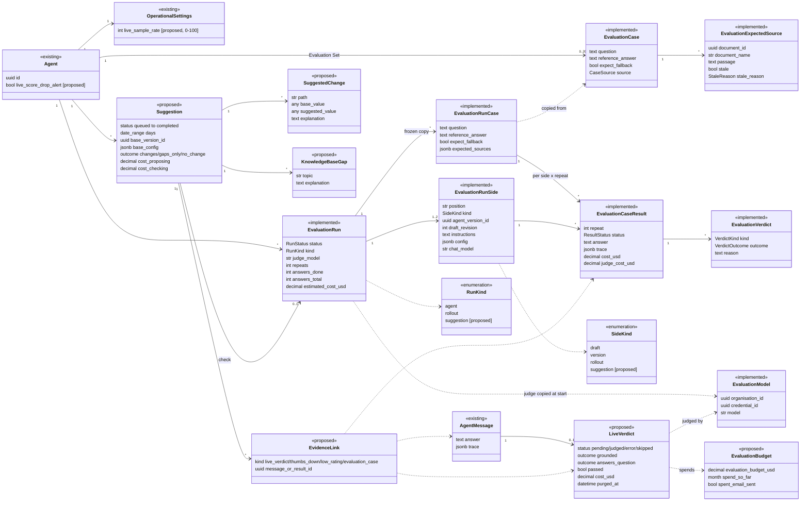
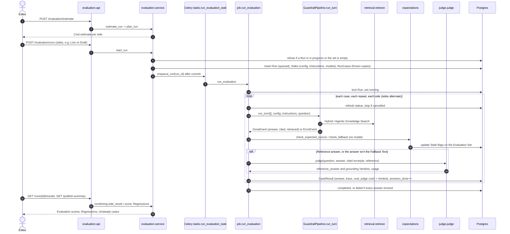
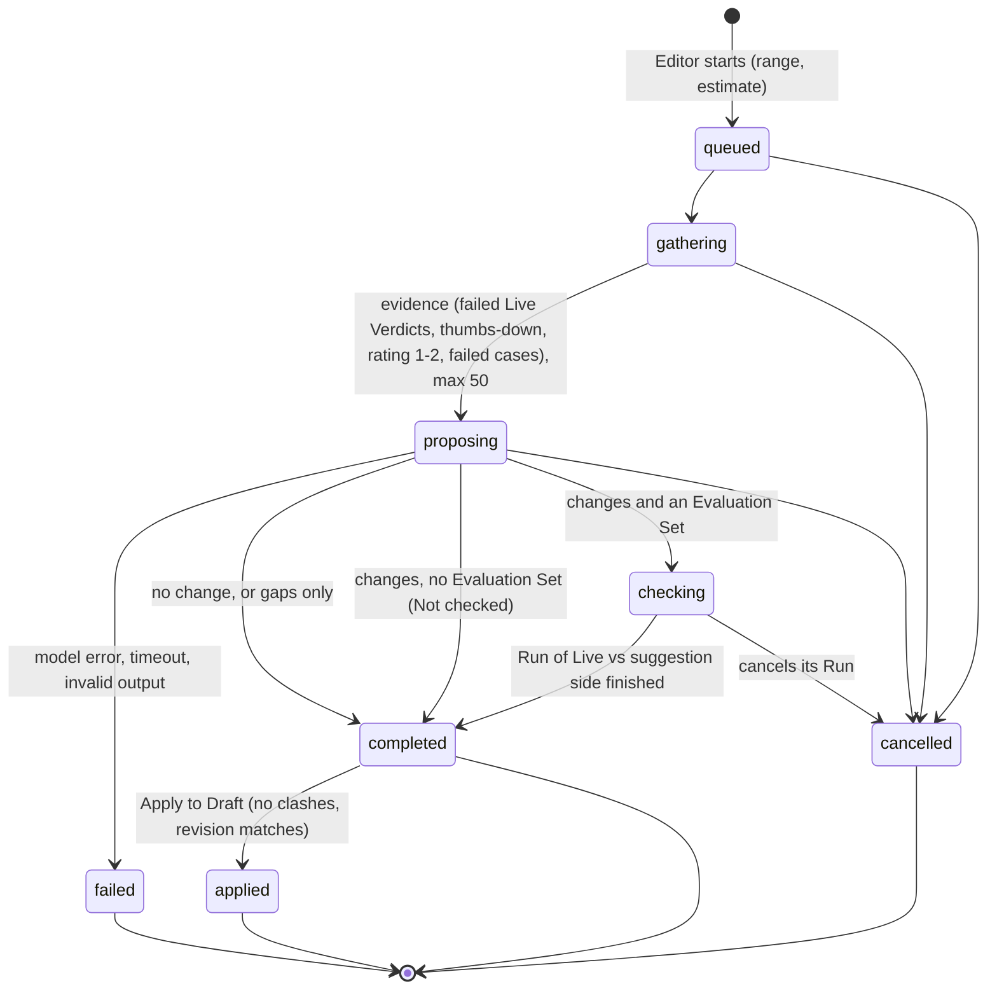

# Evaluation loop architecture

What is built and what is planned, drawn from the code in `backend/app/evaluation/` and specs 14–16.

| Spec | Scope | Status |
|---|---|---|
| [14 Evaluation loop](../specs/14-evaluation-loop-spec.md) | Evaluation Set, two-sided Evaluation Runs, judge, Publish summary, Rollout evaluation | **Implemented** (tickets 14-01…14-11 done) |
| [15 Live evaluation](../specs/15-live-evaluation-spec.md) | Live sample rate, Live Verdicts, Live score, drop alert, Evaluation budget | **Proposed** (ready-for-agent) |
| [16 Suggestions](../specs/16-suggestions-spec.md) | Suggestion runs: evidence → proposal → check → apply to Draft | **Proposed** (ready-for-agent) |

The offline Attack evaluation suite (`backend/app/evals/`, spec 08) tests the Guardrails only. It sits outside this loop, so it isn't drawn.

## 1. The loop end to end

Solid green nodes are implemented. Dashed amber nodes are proposed.

```mermaid
flowchart LR
    classDef impl fill:#dcfce7,stroke:#15803d,color:#14532d
    classDef prop fill:#fef3c7,stroke:#b45309,color:#78350f,stroke-dasharray:5 4
    classDef ext fill:#e5e7eb,stroke:#6b7280,color:#111827

    Visitor(["Visitor"]):::ext
    Editor(["Editor"]):::ext

    subgraph Serve["Serving"]
        Reply["Visitor reply<br/>Guardrail pipeline run_turn"]:::impl
        Msg[("Agent Message + Trace")]:::impl
        Fb["Message Feedback /<br/>Conversation Rating"]:::impl
    end

    subgraph S14["Spec 14 - Evaluation loop (implemented)"]
        Prefill["from_message.prefill<br/>Add to Evaluation Set"]:::impl
        Set[("Evaluation Set<br/>EvaluationCase + Expected sources")]:::impl
        Est["estimate.estimate<br/>Cost estimate"]:::impl
        Start["service.start_run<br/>snapshot sides + cases"]:::impl
        Job["job.run_evaluation<br/>Celery task"]:::impl
        Checks["expectations<br/>expected_source / fallback"]:::impl
        Judge["judge.judge<br/>reference_answer / grounding"]:::impl
        Comb["combining<br/>majority of repeats, score"]:::impl
        Summ["summary.publish_summary<br/>Regressions, stale, score drop"]:::impl
        Roll["rollout.start_rollout<br/>Rollout evaluation"]:::impl
    end

    subgraph S15["Spec 15 - Live evaluation (proposed)"]
        Sample{"Sample?<br/>Live sample rate,<br/>budget not spent"}:::prop
        LiveJob["Live judging task"]:::prop
        LV[("Live Verdict<br/>grounded + answers_question")]:::prop
        Budget[("Evaluation budget<br/>monthly spend")]:::prop
        LScore["Live score<br/>analytics rollup + Wilson"]:::prop
        Alert["Live score drop alert<br/>hourly z-test"]:::prop
    end

    subgraph S16["Spec 16 - Suggestions (proposed)"]
        Evid["Gather evidence<br/>max 50"]:::prop
        Propose["Propose<br/>Evaluation Model, structured"]:::prop
        Sugg[("Suggestion<br/>changes + KB gaps")]:::prop
        Check["Check<br/>Run kind=suggestion"]:::prop
        Apply["Apply to Draft<br/>3-way merge, clashes"]:::prop
    end

    Draft[("Draft")]:::impl
    Publish["Publish / Bulk publish"]:::impl
    Live[("Live Version")]:::impl

    Visitor --> Reply --> Msg
    Visitor --> Fb
    Live --> Reply

    Msg --> Prefill --> Set
    Editor -->|"writes / copies cases"| Set
    Editor -->|"Evaluate"| Est --> Start
    Set --> Start
    Draft --> Start
    Live --> Start
    Start --> Job
    Job --> Checks
    Job --> Judge
    Checks --> Comb
    Judge --> Comb
    Comb --> Summ --> Publish
    Publish -->|"rollout dialog"| Roll --> Start
    Draft --> Publish --> Live

    Reply -.-> Sample -.->|"chosen"| LiveJob
    LiveJob -.->|"reuses judge"| Judge
    LiveJob -.-> LV
    LiveJob -.->|"adds Cost"| Budget
    Budget -.-> Sample
    LV -.-> LScore -.-> Alert
    Alert -.->|"email Owners"| Editor
    LV -.->|"failed reply"| Prefill

    LV -.-> Evid
    Fb -.-> Evid
    Comb -.->|"failed cases on Live"| Evid
    Evid -.-> Propose -.-> Sugg
    Sugg -.-> Check -.->|"Run with suggestion side"| Start
    Sugg -.-> Apply -.-> Draft
```



## 2. Domain model

`<<implemented>>` classes exist in `backend/app/evaluation/models.py`. `<<proposed>>` classes and members marked `[proposed]`, and the `suggestion` run and side kinds, come from specs 15 and 16.



## 3. Implemented: one Evaluation Run



## 4. Proposed: Live Verdicts (spec 15)

```mermaid
sequenceDiagram
    autonumber
    actor Visitor
    participant Serve as Serving path
    participant DB as Postgres
    participant T as Live judging task
    participant J as judge.judge, extended
    participant A as analytics, hourly
    actor Owner

    Visitor->>Serve: question
    Serve-->>Visitor: reply (never waits for judging)
    Serve->>DB: store Message + DoneEvent
    alt not blocked, not Fallback Text, rate > 0, draw < rate, month's budget not spent
        Serve->>DB: LiveVerdict(pending), after commit
        Serve->>T: enqueue
        T->>DB: load Remembered turns, question, Chunks given + cited flags
        alt Message or a turn Purged
            T->>DB: LiveVerdict skipped
        else
            T->>J: grounding + answers_question, no system prompt
            J-->>T: Verdicts + usage, or error (no retry)
            T->>DB: LiveVerdict judged/error, Cost, atomic monthly spend += Cost
            opt spend reaches the budget
                T-->>Owner: budget-spent email, once
            end
        end
    end
    A->>DB: roll up judged/passed per Version per day
    A->>A: Live score + Wilson; z-test vs previous Live Version (>=30, drop >=5pts)
    A-->>Owner: Live score drop alert + email
```

## 5. Proposed: Suggestion run (spec 16)


