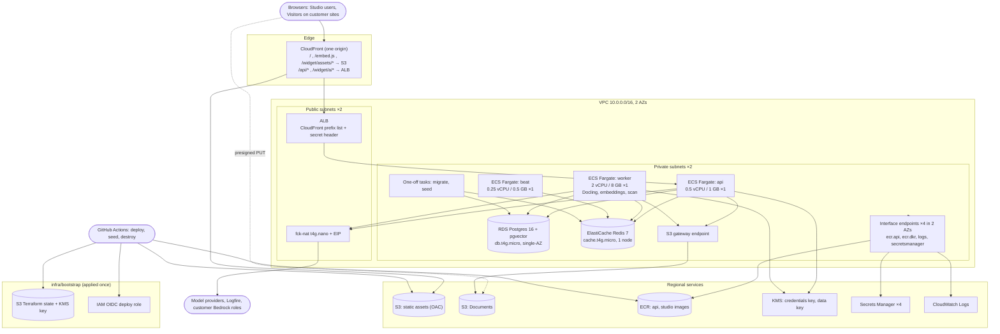
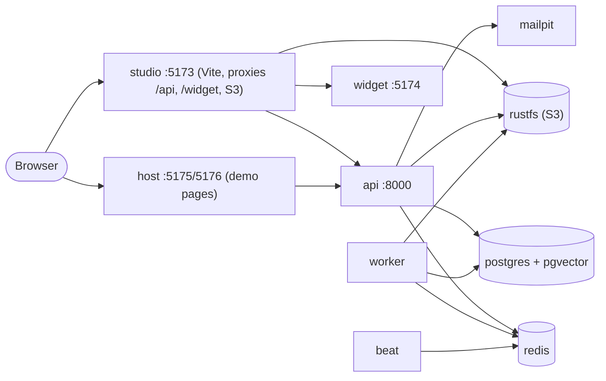
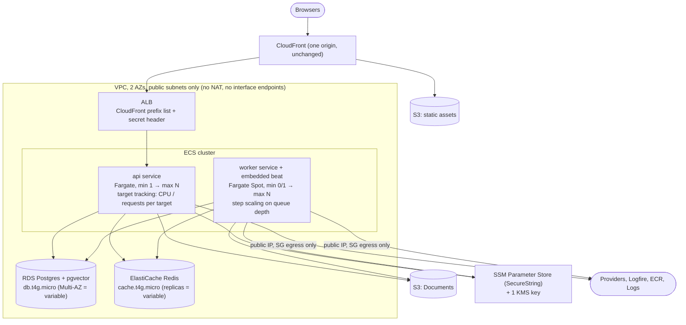
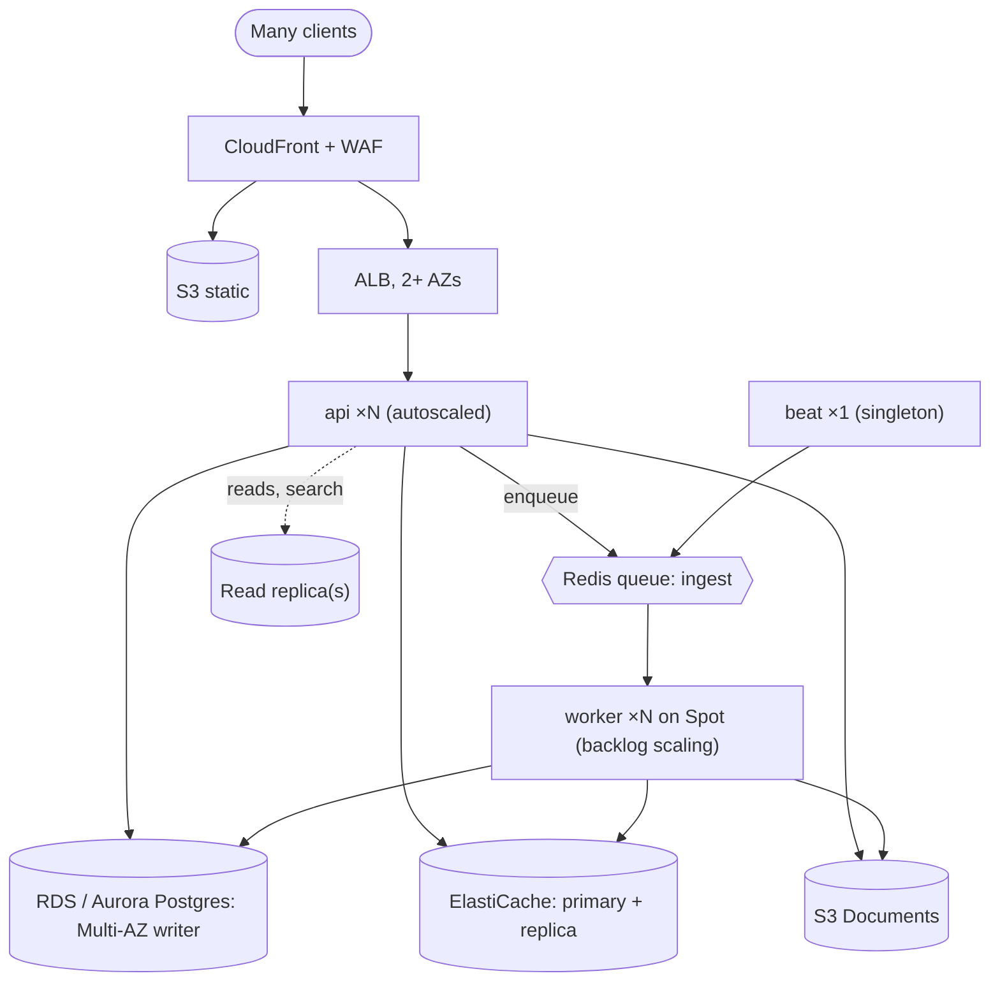
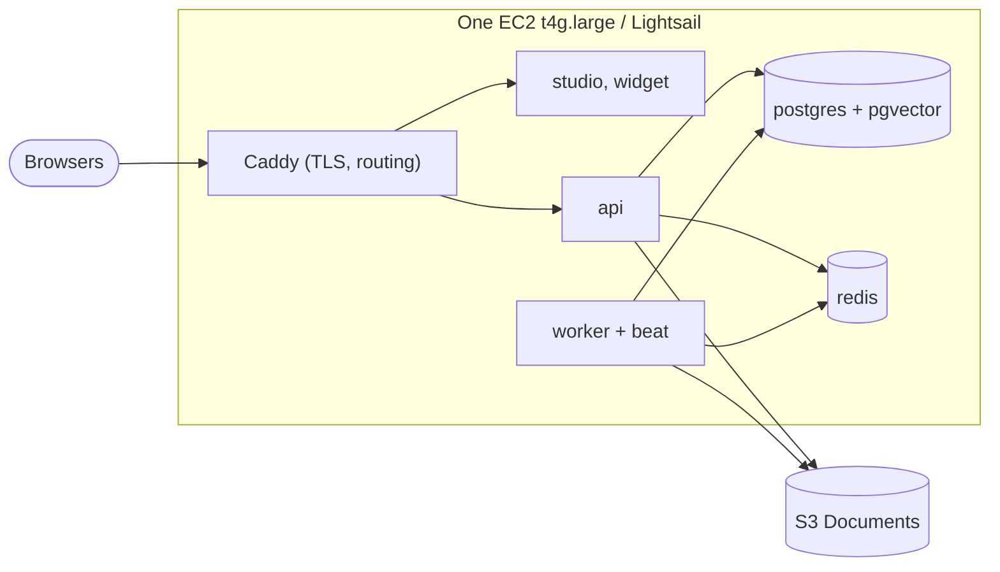

# Infrastructure: current shape and simplified maps

The AWS demo will serve a handful of clients, but it is also an interview showcase, so it should still *show* that it scales. This document maps what `infra/` deploys today and proposes leaner shapes. The scaling story stays in the code (Terraform variables, autoscaling policies, stateless services); it does not need to be running and billed all the time.

> **Decided.** Sections 3 to 5 below are the proposal as first written. What was decided differs, and is recorded in [ADR-0021](adr/0021-sqs-two-worker-pools-autoscaling.md) and [spec 22](specs/22-lean-scalable-infrastructure-spec.md):
>
> - Tasks stay in private subnets behind `fck-nat`; only the four interface endpoints go. Option A's public subnets were not adopted.
> - SQS replaces Redis as the job broker, so workers scale on queue depth. Redis stays for sessions, limits and budgets.
> - The worker splits into a general pool on Fargate Spot (1 to 3) and a runs pool on regular Fargate (0 to 2). Beat stays its own service.
> - Secrets Manager and both KMS keys stay.
> - Interruptible workers need the application work in [spec 21](specs/21-job-reliability-spec.md) first. The claim below that ingestion is safe on Spot because "Celery acks late" was wrong: it does not, and a job cut short was lost or left stuck.
> - Expected cost is about 120 USD a month left on, not the 75 to 100 below.
> - Rehearsing the deployment locally is [spec 23](specs/23-floci-rehearsal-spec.md).

Sources: `infra/envs/demo/main.tf`, `infra/modules/*`, `docker-compose.yml`, [ADR-0010](adr/0010-aws-runtime-shape.md), [ADR-0011](adr/0011-single-cloudfront-origin.md) and the [cost table](deploy-demo.md#expected-cost).

## 1. Current AWS infrastructure

Roughly 0.33 USD an hour, about 240 USD a month always on. Two items make up about 60% of that: the worker, which is sized for Docling (78 USD), and the interface endpoints (64 USD). The ALB, NAT, interface endpoints and private subnets are there for network hygiene. None of them is needed to scale.

### Current local stack (`make dev`)

The local stack is already simple. This document leaves it alone.

## 2. What actually needs to scale

The scaling claims below depend on how the app behaves, not on the infrastructure:

| Component | Scales how | State held |
|---|---|---|
| `api` | Horizontally, behind the ALB | None (sessions and limits are in Redis, data in Postgres, files in S3) |
| `worker` | Horizontally, on Redis queue depth; Celery tasks are independent | None |
| `beat` | Must stay a singleton | Schedule only |
| Postgres | Vertically, then read replicas or Aurora; pgvector HNSW indexes | Everything |
| Redis | Vertically, or a replica | Sessions, throttles, Token Budgets, MFA pending, queue |
| Static and widget assets | CloudFront, effectively without limit | None |

Redis can't be removed cheaply. Besides the Celery broker it backs sessions, sign-in throttling, MFA pending state, embed admission, Token Budgets and theme images (`backend/app/auth/*`, `backend/app/embed/*`). Postgres and Redis therefore stay managed in every option.

## 3. Option A: lean ECS (recommended)

This keeps the same services, the same Terraform layout and the same scaling story. It cuts the network plumbing and makes scaling elastic instead of fixed.

| Change | Saves per month | Why it is safe for a demo |
|---|---|---|
| Tasks in public subnets with `assign_public_ip`, security groups with no inbound except ALB → api. Remove fck-nat, the EIP and the 4 interface endpoints | ~75 USD | Nothing can reach the tasks from outside. Image pulls go direct to ECR. Keep a `private_networking` variable to restore the current layout. |
| Run Beat inside one worker (`celery worker -B`), or keep a separate `beat` service of 0.25 vCPU with `desired_count = 1` | ~8 USD | Removes a service. If the worker scales out, `-B` must run on exactly one task, so in practice the separate service is cleaner for the scaling story. |
| Worker on **Fargate Spot**, with `min = 0` between demos | ~55–78 USD | Ingestion can be redone, once spec 21 makes an interrupted job restart (it does not today). Spot capacity is the textbook answer for batch work. |
| **Application Auto Scaling** on `api` (CPU 60% target) and `worker` (backlog per task from a Redis `LLEN` metric) | Cost goes up and down with demand | This replaces fixed `desired_counts`, which `spec 09` scoped out, and it is the visible scaling demo. |
| Secrets Manager → SSM Parameter Store SecureString; 2 KMS keys → 1 (keep separate *grants*) | ~3 USD | Same encryption, no per-secret fee. Optional: keeping the credentials key separate is a talking point for ADR-0006. |

**Result:** about 75–100 USD a month always on, or about 3 USD a day applied, with real autoscaling in place of fixed counts. The diagram in an interview is the same as today plus the autoscaling arrows.

### Scale-out view (same Terraform, different variables)

This is how to show scale without paying for it: the variables that turn Option A into a production-sized shape.

| Variable | Demo | Scaled |
|---|---|---|
| `autoscaling.api` (min/max) | 1 / 3 | 2 / 20 |
| `autoscaling.worker` (min/max, spot) | 0 / 3, Spot | 1 / 30, Spot + on-demand base |
| `database.instance_class`, `multi_az`, `read_replicas` | t4g.micro, false, 0 | r7g.large, true, 1+ |
| `cache.node_type`, `replicas` | t4g.micro, 0 | r7g.large, 1 |
| `private_networking` | false | true (restores NAT and endpoints) |

## 4. Option B: single host (cheapest, for comparison)

Run `docker-compose.yml` as it is on one Graviton EC2 or Lightsail instance, with Caddy for TLS and S3 for Documents.

It costs about 30–50 USD a month and the deployment is one `docker compose up`. **It does not demonstrate scalability.** The only scaling story is "move to Option A", and it throws away the Terraform, CloudFront and IAM work that is already a strength of the repository. It is not recommended for the showcase.

## 5. Recommendation

Adopt **Option A** and keep the scale-out view as a diagram:

1. `network`: add `private_networking` (default `false`): public subnets only, no fck-nat, no interface endpoints.
2. `ecs`: replace `desired_counts` with `autoscaling` (min/max per service), add `aws_appautoscaling_*` for `api` (CPU) and `worker` (backlog metric), and add a Fargate Spot capacity provider for the worker.
3. Keep `beat` as its own singleton service, which is clearer than `-B` once the worker scales.
4. Optional: move to SSM Parameter Store and one KMS key.
5. Update ADR-0010 (or add a new ADR) and the cost table in `deploy-demo.md`.

This keeps the parts that tell the scaling story (stateless services, an ALB, a queue with workers, a managed database and cache, CloudFront) and removes only the networking that a two-client demo pays for without using.
