# Design review: `candidate-reskin` (at `8cd1483`)

Reviewed with Playwright against a locally seeded stack (`make seed`, signed in as the demo Owner),
at 1440×900 and 390×844. Screenshots are in this folder. Each finding gives what is wrong, the
cause in the code, and a fix written so it can go straight into a spec ticket.

**Reference look**: the Project's **Agents** list (`projects/AgentsTab.tsx`) and **Documents** list
(`projects/DocumentsTab.tsx`): `PageHeader` with the one primary action on the right, a toolbar
(`Segmented` filter), then a `table.wrap` card built from the `table.*` recipes, `EmptyState` /
`Skeleton` for empty and loading, `Notice` for messages, and `Dialog` for create forms.

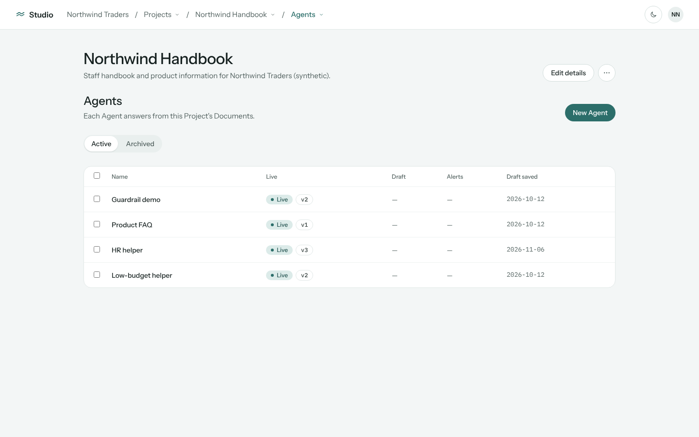

---

## 1. Organisation Projects list is not reskinned

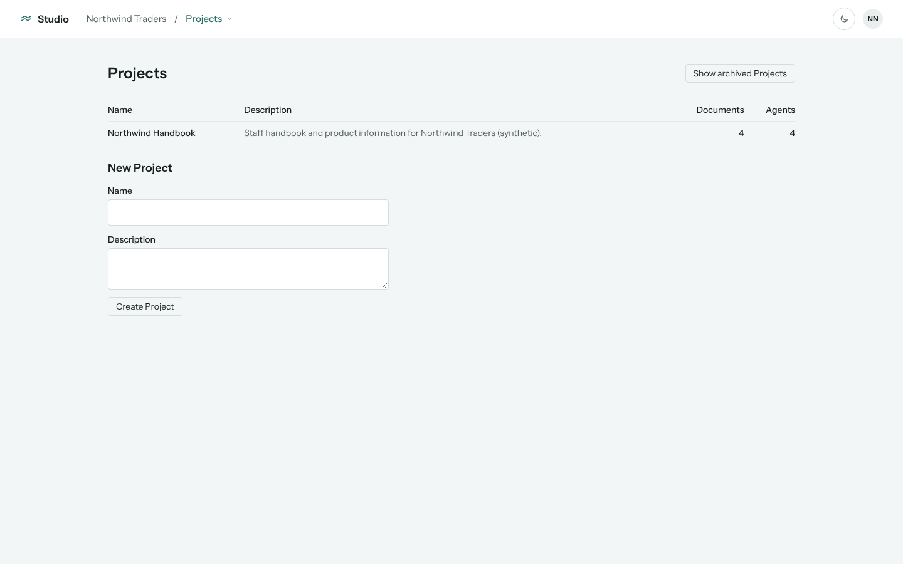

**What's wrong.** The title is `text-2xl font-semibold`, not `text.title`. The table is a bare
`<table>` (no card, black underlined links, column headings at body size). "Show archived Projects"
is an old square bordered button. The loading, error and empty states are plain `<p>`s, and the
"deleted"/"restored" messages are coloured text, not `Notice`s.

**Cause.** `projects/ProjectsPage.tsx` still uses its own `BUTTON` and `INPUT` strings. It also
exports them, and `EmbeddingModel.tsx`, `AgentBranding.tsx` and `cost/CostPage.tsx` import them.

**Fix.**
- `PageHeader` (level 1) titled "Projects", with a description (e.g. "Each Project holds Documents
  and the Agents that answer from them.") and **New Project** as the `button.primary` action
  (see 3).
- Toolbar: a `Segmented` "Projects shown" with Active / Archived, replacing the toggle button, as
  on Agents.
- Active table in `table.wrap` / `table.table`: Name (`table.link`, no underline), Description
  (`table.tdMuted`, truncated to one line), Documents and Agents (`table.thNumeric` /
  `table.tdNumeric`). Optional: a row ⋯ menu (`button.iconBare`) with Archive.
- Archived table: same card. Name, Archived date (mono, `table.tdMuted`), and Restore as a
  `button.secondary` or a ⋯ menu item (Owners only). Keep the explanatory line above it as
  `text-sm text-muted`, as Agents does.
- States: `Skeleton label="Loading Projects"`; an error `EmptyState tone="error"`;
  `EmptyState icon="projects"` for "No Projects yet" and "No archived Projects".
- `deleted` and `restored` messages use `Notice tone="success"` (or a toast for Restore, as other
  row actions do).
- Remove the `BUTTON` and `INPUT` exports. Move `EmbeddingModel.tsx`, `AgentBranding.tsx` and
  `CostPage.tsx` onto `button.*` / `field.*`. `ProjectFields` uses `field.label`, `field.input`
  and `field.textarea`.

## 2. Organisation cost table is not reskinned

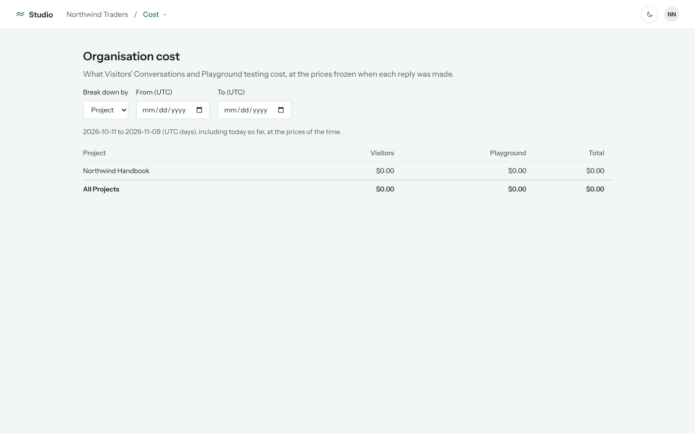

**What's wrong.** The title is `text-2xl font-semibold`. The filters use the old `INPUT` (square,
full-width style), and their labels sit in a row of uneven widths. The table is bare, with no card,
and its amounts aren't mono.

**Cause.** `cost/CostPage.tsx` predates the recipes; it has its own `CELL` and `AMOUNT` strings.

**Fix.**
- `PageHeader` titled "Organisation cost", with the existing sentence as its `description`.
- Toolbar (`layout.toolbar`): "Break down by" as a `Segmented` (Project / Agent), since there are
  only two options. From and To are date filters using `field.filter` and `field.pill`, as on
  Conversations and Analytics. (AuditPage's own `FILTER` string should move to these too.)
- The period line (`2026-10-11 to 2026-11-09 (UTC days)…`) goes under the toolbar as
  `text.small`/`text.muted`.
- Table in `table.wrap`: `table.th` / `table.thNumeric` headings; name cells as `table.td`
  (`font-medium`); amounts as `table.tdNumeric`. The `tfoot` total row gets `border-t border-line`
  and `font-medium`, and keeps the numeric recipe. Keep the existing focusable `role="region"`
  wrapper behaviour; `table.wrap` already scrolls.
- Optional: a `StatCard` row above the table (Total, Visitors, Playground) to match Documents.
- States: `Skeleton`; error `Notice tone="error"` (keep the 422 date message); "Nothing was spent
  in this period" as `EmptyState icon="analytics"`; non-Owner message as `EmptyState`.

## 3. Create Project form is unstyled and sits under the list

(Visible in the Projects screenshot above.)

**What's wrong.** `NewProjectForm` always renders below the table with old `INPUT`/`BUTTON`
styles. There is no primary action in the header.

**Fix.** Copy `NewAgentDialog`:
- Delete the inline `NewProjectForm`. Add **New Project** (`button.primary`) to the Projects
  `PageHeader` actions. Hide it while Archived is selected, as New Agent hides on an archived
  Project.
- Clicking it opens `<Dialog open title="New Project" closeButton={false}>` with
  `<form aria-label="New Project">`: `ProjectFields` (Name required, Description `field.textarea`
  `rows={3}`), `FormError`, then a right-aligned footer with Cancel (`button.secondary`) and
  Create Project (`button.primary`, "Creating…" while pending).
- On success, navigate to the new Project (as now). Cancel and Escape close the dialog without
  creating anything, and focus returns to New Project.
- The `projects.spec.ts` e2e and the Projects page unit tests move to: open the dialog, fill it,
  submit.

## 4. Invite someone form should be a modal

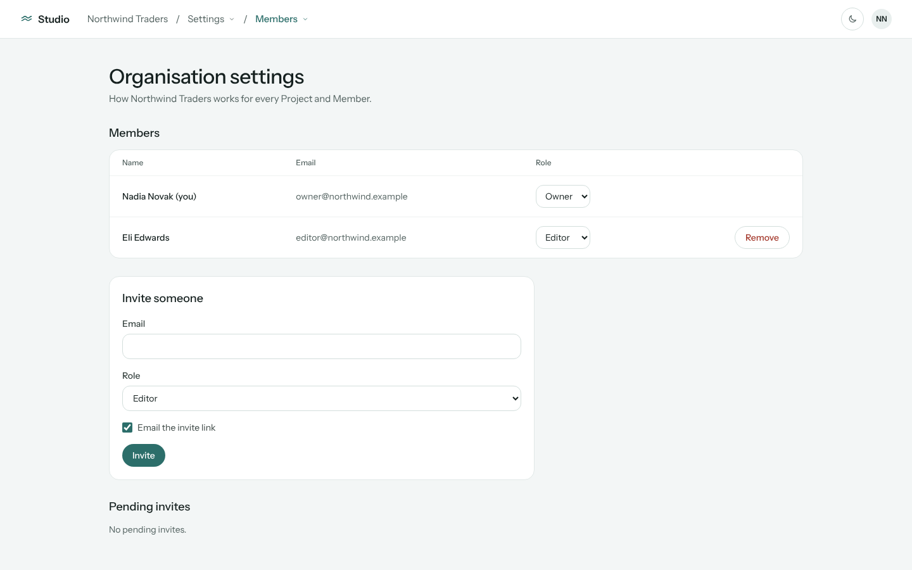

**What's wrong.** The invite form is a large panel between the Members table and Pending invites.
It pushes Pending invites below the fold, and there is no header action.

**Fix.**
- The Members section header becomes `PageHeader level={2}` titled "Members", with **Invite
  someone** (`button.primary`) on the right, as with New Agent.
- That button opens `<Dialog title="Invite someone">` with the same fields (Email, Role
  `field.select`, "Email the invite link" checkbox), `FormError`, and a footer with Cancel and
  Invite.
- On success: close the dialog, show the existing toast, and keep showing the `InviteLink` panel
  (copy link, expiry) on the page above Pending invites, because the Owner needs it after the
  dialog closes. Alternative: switch the dialog to a "Invite sent" step with the link and a Done
  button. Pick one in the spec; showing it on the page is the smaller change.
- `PendingRow`'s New link also shows `InviteLink`, so leave that panel where it is.
- Also: `MembersList` has its own `SELECT` string. Switch it to a shared compact select recipe
  (see 5).

## 5. Select dropdown chevrons have no right padding

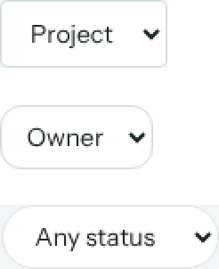

**What's wrong.** Every `<select>` keeps the browser's native arrow (`appearance: auto`). Chrome
draws it a few px from the border, whatever the padding, so it sits against the right edge while
the text has 10–14 px on the left. Measured: `field.select` / `field.pill` have
`padding-right: 12–14px` but the arrow ignores it; `MembersList`'s `SELECT` has 10 px.

**Where.** 23 selects: `field.select` (most), `field.pill` (Conversations, Analytics, Version
comparison, Documents status), the legacy `INPUT` (CostPage, EmbeddingModel), `MembersList`
`SELECT`, AuditPage `FILTER`, and DraftEditor's `fields.select`.

**Fix (one place, covers all of them).** In `design/tokens.css`, add a base rule:

```css
@layer base {
  select:not([multiple]):not([size]) {
    appearance: none;
    padding-right: 2.25rem;               /* text never runs under the chevron */
    background-image: var(--ds-select-chevron);
    background-repeat: no-repeat;
    background-position: right 0.75rem center;
    background-size: 1rem;
  }
}
```

Define `--ds-select-chevron` as an inline-SVG data URI of the design system's `chevronDown` icon (`design/Icon.tsx`),
stroked in the `muted` colour. Give it a light value and a dark value in the same places the other
tokens switch: the system-preference block and `[data-appearance="dark"]`. Then:
- Remove `px-3` / `px-3.5` right padding conflicts: keep left padding in the recipes and let the
  base rule own `padding-right` (or set `pr-9` in `field.select`, `field.pill` and a new
  `field.selectCompact` for table cells, replacing `MembersList`'s `SELECT`).
- Add a disabled style: `select:disabled` uses `opacity` or a dimmer chevron token.
- Add a test: a unit test in `tokens.test.ts` that the rule and both chevron tokens exist, and a
  Playwright check that a select's computed `appearance` is `none` and its `padding-right` is at
  least 36 px.

## 6. Project Settings is not reskinned

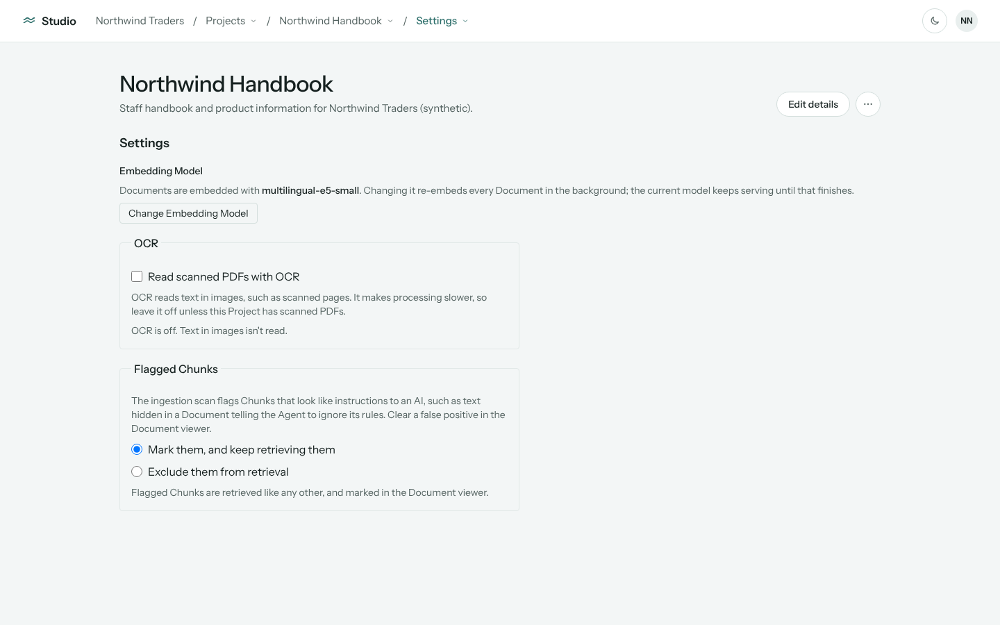

**What's wrong.** The heading is `text-lg font-semibold`. Embedding Model is a loose block with an
old square button. OCR and Flagged Chunks are `<fieldset>`s with a legend notched into a square
border (`rounded border p-4`, `max-w-xl`), with browser-default checkbox and radios. Each section
looks different.

**Cause.** `ProjectSettingsTab.tsx` and `EmbeddingModel.tsx` were not part of 11-05 or 11-11; they
still use `BUTTON` and `INPUT`.

**Fix.** Match Organisation settings (11-11):
- `PageHeader level={2}` titled "Settings", with a description: "How this Project's Documents are
  read and retrieved."
- Each setting is a `Section` card (or a `surface.panel`) with a `text.subheading` title, a
  `text.muted` explanation, then its control, the full content width:
  - **Embedding Model**: current model in mono with a `Badge` or plain text; **Change** as
    `button.secondary`. Choosing a model opens a `Dialog` ("Change the Embedding Model") with the
    `field.select` and the re-embed warning as `Notice tone="warning"`, plus Cancel and Use this
    model. Re-embed progress uses the design system's `Meter` instead of `<progress>`, and a
    failure uses `Notice tone="error"`.
  - **OCR**: a labelled switch or `field.checkbox` row with the hint below. The status line is
    `text.small`.
  - **Flagged Chunks**: the two choices as a radio card group (or `Segmented` with a description
    below), keeping `role="radiogroup"` and the existing behaviour: optimistic and disabled while
    saving.
- Remove the fieldset legend-in-border styling (keep `fieldset`/`legend` for accessibility, but
  with `sr-only` or `text.subheading` legends and no border).
- Errors use `FormError` / `Notice tone="error"` at the top of the card.

## 7. Edit Project details should be a modal

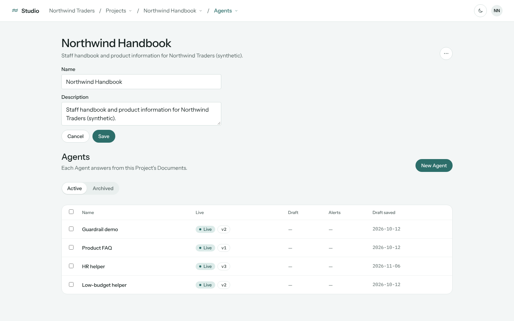

**What's wrong.** Edit details puts an old-style form (square `INPUT` fields from `ProjectFields`)
between the Project header and the section, pushing the page down. The Edit details button
disappears while the form is open.

**Fix.**
- **Edit details** opens `<Dialog title="Edit Project details" closeButton={false}>` holding
  `<form aria-label="Project details">`: `ProjectFields` (reskinned, see 1), `FormError`, and a
  Cancel / Save footer (`button.secondary` / `button.primary`, "Saving…").
- The button stays visible; nothing is rendered inline in `ProjectHeader`.
- Save closes the dialog and shows the toast "Project details saved". Cancel and Escape discard
  changes.
- Reuse the same dialog layout as New Project (3), so they share a `ProjectDetailsDialog` with a
  `mode: "create" | "edit"`.

## 8. The main navigation is convoluted

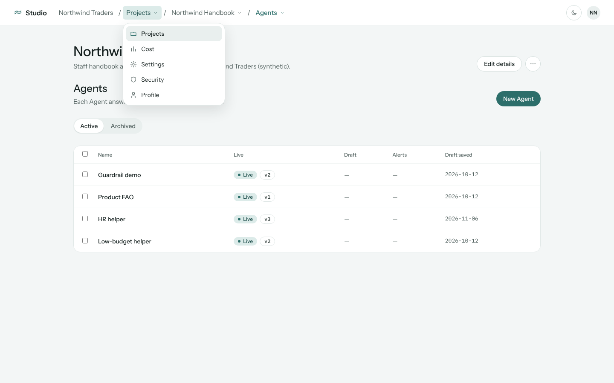
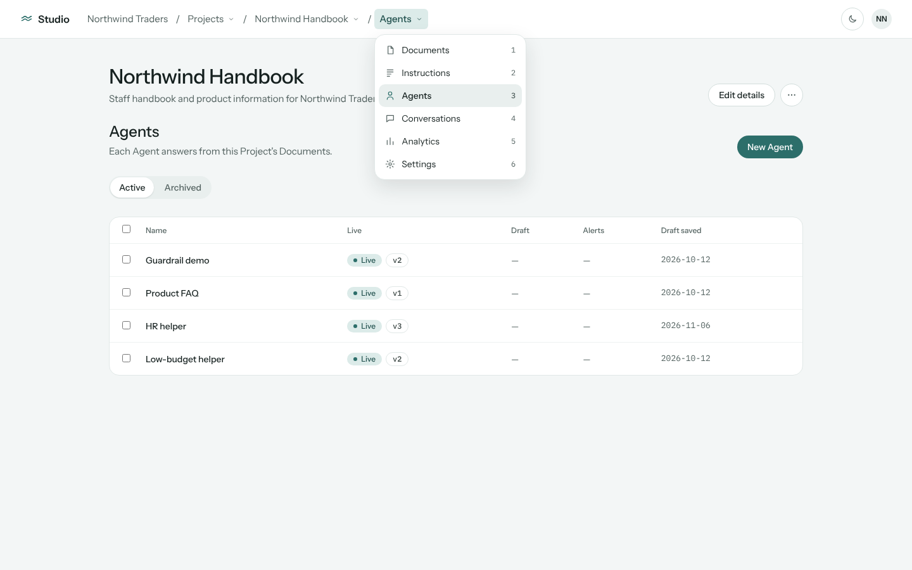
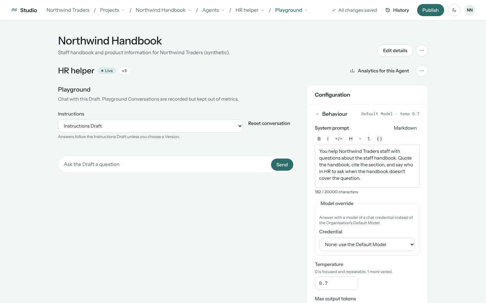
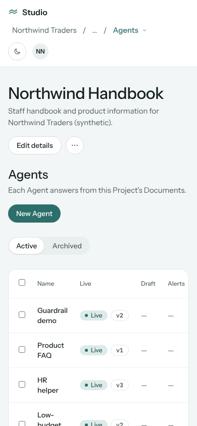

**What makes it hard to use** (seen in the review):
1. **Nothing is visible.** Every destination sits inside a breadcrumb dropdown. To reach Cost or
   Settings you must know to open the crumb labelled "Projects". To reach Conversations you must
   open the crumb labelled with the current section ("Agents").
2. **The crumbs mean two things.** "Projects ▾" is both where you are and a menu of the
   Organisation's sections. "Agents ▾" is both the current section and a section switcher. The
   label changes as you move, so you can't build a habit.
3. **Duplicate and odd entries.** Security and Profile are in the Organisation's section menu *and*
   the account menu. The Project section menu shows the numbers 1–6 beside each item. They are visual labels only (`MenuItem.hint`), not keyboard shortcuts, so they look like shortcuts that do nothing.
4. **Deep paths.** An Agent is `Org / Projects ▾ / Project ▾ / Agents ▾ / HR helper ▾ /
   Playground ▾`: six crumbs, five menus. Under it the page stacks three headings: the Project h1
   with its actions, the Agent h2 with its actions, and the view heading.
5. **Narrow screens.** At 390 px the top bar wraps into three rows, and the folded "…" hides
   exactly the Project and section crumbs you need.

**Concepts considered.**

| | Concept | For | Against |
| --- | --- | --- | --- |
| A | **Left sidebar (contextual)** | Every destination visible. The current one is highlighted. Familiar from Supabase, Vercel and Linear. Scales to an Agent's views. | Takes about 240 px of width. Needs a drawer on mobile. Reverses design principle 3. |
| B | **Top tabs under the header** (Org tabs in the top bar; a Project tab row under the Project title; Agent view tabs under the Agent title) | Visible. Keeps full width. Small change. | Three tab rows on an Agent page. Org-level tabs crowd the top bar alongside the page's actions (Publish, History). |
| C | **Keep the breadcrumb, add a ⌘K command palette** | Smallest change. | Discoverability stays poor. A palette helps power users, not first-time Members. |

**Decision: A, a contextual left sidebar, with a plain (non-menu) breadcrumb in the top bar.** Chosen 2026-11-09. The draft ADR is [0014-sidebar-navigation.md](0014-sidebar-navigation.md).

- **Sidebar, top to bottom:**
  - The Organisation switcher (name + ▾; plain text for a Member of one).
  - Organisation links: **Projects**, **Cost** (Owners), **Settings**.
  - When inside a Project: a divider, the **Project switcher** (name + ▾, listing open Projects
    and "All Projects"), then its sections as links with their icons: Documents, Instructions,
    Agents, Conversations, Analytics, Settings.
  - The current link uses the soft accent fill (the existing "current crumb" style), with
    `aria-current="page"`.
- **Top bar:** brand, a breadcrumb of plain links (`Project / Agents / HR helper`) with no menus,
  the page's own actions (Publish, History, saved state), the appearance toggle and the account
  menu. Profile, Security and Sign out live **only** in the account menu.
- **Agent pages:** the Agent's views (Playground, Versions, Embed & limits, Conversations) become
  a tab row (`Segmented` or underline tabs) under the Agent's header, not a crumb menu. The Agent
  switcher moves into the Agent header title as an optional ▾. Drop the Project `PageHeader` on
  Agent pages: the sidebar and breadcrumb already say which Project you're in. That removes the
  stacked h1/h2/h3.
- **Narrow (< `md`):** the sidebar becomes a drawer opened by a menu button in the top bar
  (focus-trapped, Escape closes, the current link focused on open). The breadcrumb shows only its
  last two crumbs.
- **Numbers:** drop the 1–6 hints. If shortcuts are wanted, make them real (e.g. `g d` for
  Documents) and show them as `kbd` hints in the sidebar.
- **Docs and decisions:** this reverses design principle 3 ("Navigation lives in the top bar's
  breadcrumb") and the README's *Navigation: the breadcrumb* section. The draft
  [ADR-0014](0014-sidebar-navigation.md) moves to `docs/adr/` with the ticket. Update the design
  README (principle 3, the navigation table, *Navigation: the breadcrumb*) and GLOSSARY (Breadcrumb
  fold and Crumb switcher go; add Sidebar and Sidebar drawer).
- **Tests:** the e2e navigation helpers (`fixtures/`) and `breadcrumb`/`shell` unit tests move from
  opening crumb menus to clicking sidebar links. The 11-13 axe and keyboard pass is rerun for the
  sidebar and drawer.

---

## Also noticed (not in the brief)

- `projects/AgentBranding.tsx` still imports the legacy `BUTTON` and `INPUT`. It will break when
  those exports are removed in 1, so reskin it at the same time.
- The Agent page's Instructions select and Model override select show the same chevron problem
  (5).
- On narrow screens, the Agents table's Name column wraps to two or three lines ("Low- / budget /
  helper"). A `min-w` or `whitespace-nowrap` on `table.link` cells would help, and so would the
  other tables built in 1 and 2.

## Suggested ticket split

| Ticket | Covers | Blocked by |
| --- | --- | --- |
| Select chevron token and base rule | 5 | — |
| Project details dialog (create + edit) | 3, 7 | — |
| Projects list reskin, removing `BUTTON`/`INPUT` | 1 (+ AgentBranding, EmbeddingModel imports) | Project details dialog |
| Organisation cost reskin | 2 | Select chevron |
| Invite dialog | 4 | — |
| Project Settings reskin | 6 | Projects list reskin (removes `BUTTON`/`INPUT`) |
| Sidebar navigation (ADR-0014) | 8: sidebar, drawer, plain breadcrumb, account menu cleanup | — (land last; touches every page's e2e helpers) |
| Agent view tabs | 8: Agent views as tabs, Agent switcher on the title, one h1 on Agent pages | Sidebar navigation |
