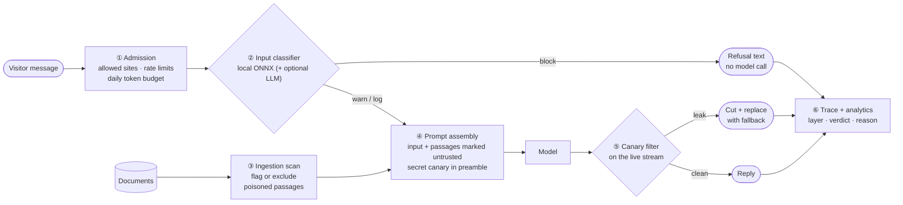

# Agentic guardrails in production

**The problem:** an anonymous public chat box, wired to private documents and a paid model key. Attackers will try to override instructions, leak the system prompt, or hide instructions inside uploaded documents.

**The rule that matters most:** Agents get **no tools that act outside the conversation**. If an attack gets through, the worst case is a bad answer, never an action. Every other layer is defence in depth on top of that.

| Layer | What it stops | Key design choice |
|---|---|---|
| ① Admission | Cost abuse, embedding on other sites | Bounds abuse it can't prevent; limits change live, no publish needed |
| ② Input classifier | Direct injection, jailbreaks | Local model by default: free, no setup, deterministic. Block, warn or log per Agent; LLM check can fail open or closed |
| ③ Ingestion scan | Instructions hidden in documents | Caught once at upload, not on every request |
| ④ Spotlighting + canary | Injected text being obeyed; prompt leaks | Data is always labelled as data; a fresh secret on every request |
| ⑤ Canary filter | System-prompt leaks the classifier missed | Holds back a canary-length buffer so a leak split across tokens never reaches the screen |
| ⑥ Trace + alerts | Silent failure | Every block logged with a reason; block rate per Version; spike alerts |

**Proving it works:** an attack suite (overrides, prompt extraction, role-play, poisoned documents, encoding tricks, multi-turn) plus harmless controls runs on **every PR** against a deliberately *naive* mock model that would obey any injection, so it tests the guardrails rather than the model. It runs **nightly** against a real model with a pass-rate report.

**Being honest about limits:** no layer is perfect, and an encoded leak can only be flagged after it has streamed. The claim is a small blast radius, independent layers, and measured resilience.

Design per [ADR-0007](../adr/0007-layered-prompt-injection-defence.md) and [spec 08](../specs/08-guardrails-evaluation-spec.md); built on the `candidate` branch.
