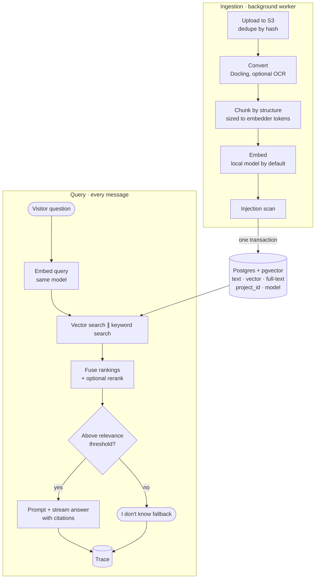

# RAG pipelines

**The job:** turn messy files into grounded, cited answers, kept strictly separate per Project, with every answer explainable and every change reversible.

**Design choices**

- **Extraction first.** Docling reads layout, tables and slides, and Editors can see the converted text. Most bad answers start as bad extraction.
- **Structure-aware chunks** keep heading paths and page numbers, which become the citations.
- **Local embeddings by default** mean no API key is needed to start, there's no per-chunk cost, and tests are deterministic. Each vector records its model, and switching models is **blue/green**: old vectors serve until the new set is complete.
- **One database.** Postgres + pgvector gives deletes in one transaction and isolation with a plain `project_id` filter. A separate vector DB isn't worth it at this scale.
- **Hybrid search.** Vector search finds meaning, keyword search finds exact codes and names, and reciprocal rank fusion combines them without score tuning.
- **"I don't know" is a feature.** A relevance threshold triggers the fallback instead of a guess, and the fallback rate shows where the Knowledge Base has gaps.
- **Citations are checked**, resolved back to passages that were actually retrieved.
- **Every answer has a Trace:** what was retrieved, cited and filtered out (and why), plus model, tokens, cost and latency.
- **Versioned Agents.** Prompt, model and retrieval settings are frozen into Versions that can be compared side by side and reverted with one click.

Design per [ADR-0001](../adr/0001-pgvector-hybrid-search.md), [ADR-0002](../adr/0002-local-embeddings-by-default.md), [spec 03](../specs/03-projects-knowledge-base-spec.md) and [spec 04](../specs/04-agents-retrieval-playground-spec.md); not yet implemented.
